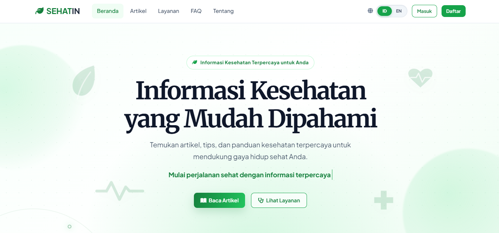

# SEHATIN - Portal Kesehatan Digital Terpadu

**SEHATIN** adalah aplikasi web portal informasi kesehatan berbasis Laravel yang dirancang untuk membantu masyarakat mendapatkan informasi kesehatan yang mudah dipahami, terstruktur, dan dapat dikelola secara profesional melalui panel admin. Aplikasi ini menggabungkan edukasi kesehatan, direktori obat, informasi penyakit, panduan hidup sehat, fitur komunitas, konsultasi sederhana, pencarian terpadu, personalisasi pengguna, multi bahasa, PWA, serta penguatan keamanan untuk kebutuhan demonstrasi dan deployment.

> Tagline: **Sehat dimulai dari informasi yang tepat.**

---

## Daftar Isi

- [Gambaran Umum](#gambaran-umum)
- [Nilai Unggul untuk Lomba](#nilai-unggul-untuk-lomba)
- [Fitur Unggulan](#fitur-unggulan)
- [Keamanan dan Kesiapan Launch](#keamanan-dan-kesiapan-launch)
- [Teknologi](#teknologi)
- [Akun Demo](#akun-demo)
- [Panduan Instalasi](#panduan-instalasi)
- [Panduan Demo untuk Juri](#panduan-demo-untuk-juri)
- [Struktur Menu dan Route Utama](#struktur-menu-dan-route-utama)
- [Struktur Folder Penting](#struktur-folder-penting)
- [Database dan Data Awal](#database-dan-data-awal)
- [Testing dan Quality Assurance](#testing-dan-quality-assurance)
- [Konfigurasi Production](#konfigurasi-production)
- [Screenshot Dokumentasi](#screenshot-dokumentasi)
- [Troubleshooting](#troubleshooting)
- [Perintah Penting](#perintah-penting)

---

## Gambaran Umum

SEHATIN dibangun sebagai solusi digital kesehatan yang tidak hanya menampilkan artikel, tetapi juga menghadirkan ekosistem informasi kesehatan yang lengkap dan interaktif. Pengguna dapat membaca artikel edukatif, mencari obat, mempelajari penyakit, mengikuti panduan hidup sehat, menggunakan kalkulator kesehatan, berdiskusi di komunitas, menyimpan artikel favorit, serta mengakses fitur konsultasi berbasis pesan.

Dari sisi pengelola, SEHATIN menyediakan panel admin untuk mengatur konten secara mandiri tanpa harus mengubah kode. Admin dapat mengelola artikel, kategori, layanan, obat, penyakit, panduan kesehatan, FAQ, halaman statis, moderasi komunitas, konsultasi pengguna, dan profil admin.

| Item | Keterangan |
| --- | --- |
| Nama aplikasi | SEHATIN |
| Jenis aplikasi | Portal kesehatan digital dan content management system |
| Fokus utama | Edukasi kesehatan, direktori informasi medis, komunitas, dan layanan pengguna |
| Framework | Laravel 12 |
| Bahasa utama | PHP 8.2+, Blade, JavaScript, CSS |
| Database | MySQL untuk production, SQLite untuk testing |
| Role pengguna | Guest, User, Admin |
| Bahasa | Indonesia dan Inggris |
| Status | Siap demo, siap pengembangan, dan siap diarahkan ke deployment production |

---

## Nilai Unggul untuk Lomba

SEHATIN dirancang bukan hanya sebagai website informatif, tetapi sebagai platform yang memperhatikan **kebutuhan pengguna, kelengkapan fitur, pengalaman visual, keamanan, dan kemudahan pengelolaan**.

### 1. Solusi Relevan untuk Masalah Nyata

Informasi kesehatan sering tersebar, tidak rapi, dan sulit dipahami oleh masyarakat umum. SEHATIN menyatukan informasi kesehatan dalam satu portal yang mudah dicari, mudah dibaca, dan memiliki navigasi yang jelas.

### 2. Fitur Lengkap dalam Satu Platform

SEHATIN tidak berhenti pada artikel kesehatan. Aplikasi ini juga menyediakan direktori obat, informasi penyakit, panduan hidup sehat, FAQ, pencarian terpadu, komunitas diskusi, konsultasi pengguna, bookmark, riwayat pencarian, kalkulator BMI, kuis kesehatan mental, serta halaman SDG.

### 3. Siap Dipakai oleh Pengelola Non-Teknis

Panel admin memungkinkan pengelola menambah dan memperbarui konten tanpa menyentuh source code. Ini membuat SEHATIN realistis untuk digunakan oleh sekolah, organisasi, komunitas kesehatan, klinik, atau tim edukasi digital.

### 4. Pengalaman Pengguna Modern

Tampilan responsif, multi bahasa, mode aksesibilitas, PWA, halaman offline, pencarian saran, dan navigasi mobile membuat aplikasi terasa seperti produk digital yang matang.

### 5. Keamanan Diperhatikan sejak Awal

SEHATIN sudah dilengkapi autentikasi, role admin, CSRF protection, rate limiting login/register, session hardening, security headers, validasi input, sanitasi HTML untuk mencegah stored XSS, dan test keamanan.

### 6. Mudah Didemokan dan Mudah Diuji

Project menyediakan seeder, akun demo, dokumentasi instalasi, route yang jelas, dan test suite otomatis sehingga juri dapat melihat kualitas teknis sekaligus kualitas produk.

---

## Fitur Unggulan

### 1. Landing Page Informatif

Beranda SEHATIN menjadi pintu masuk utama bagi pengguna. Halaman ini menampilkan identitas aplikasi, navigasi layanan, artikel pilihan, dan akses cepat ke fitur-fitur utama.

Keunggulan:

- Desain responsif untuk desktop dan mobile.
- Navigasi jelas menuju artikel, layanan, obat, penyakit, panduan, komunitas, dan fitur kesehatan.
- Cocok untuk demo karena langsung memperlihatkan cakupan sistem.

### 2. Artikel Kesehatan Berbasis Kategori

SEHATIN menyediakan modul artikel kesehatan yang dapat digunakan untuk edukasi publik.

Fitur:

- Daftar artikel published.
- Detail artikel dengan URL slug yang rapi.
- Kategori artikel.
- Artikel terkait.
- Metadata kepercayaan seperti reviewer dan tanggal review.
- Bookmark artikel untuk pengguna login.
- Cache-control khusus untuk halaman yang berkaitan dengan user.

Manfaat untuk juri:

- Menunjukkan bahwa aplikasi bukan sekadar CRUD, tetapi memiliki alur publikasi konten yang terstruktur.
- Mendukung konsep literasi kesehatan digital.

### 3. Bookmark Artikel

Pengguna yang login dapat menyimpan artikel favorit agar mudah dibaca kembali dari halaman profil.

Fitur:

- Simpan artikel.
- Hapus artikel tersimpan.
- Daftar artikel tersimpan di profil user.
- Proteksi auth agar hanya pengguna login yang dapat menggunakan fitur ini.

### 4. Direktori Obat

Modul direktori obat membantu pengguna mencari informasi umum mengenai obat.

Fitur:

- Daftar obat aktif.
- Pencarian berdasarkan nama obat.
- Filter kategori obat.
- Filter alfabet berdasarkan huruf awal.
- Detail obat berisi nama generik, bentuk obat, produsen, kandungan, indikasi, dosis, cara pakai, efek samping, kontraindikasi, peringatan, dan estimasi harga.
- Admin dapat menambah, mengubah, menghapus, dan mengaktifkan/nonaktifkan data obat.

Nilai unggul:

- Informasi obat disajikan terstruktur sehingga lebih mudah dipahami.
- Cocok sebagai fitur pembeda karena tidak semua portal lomba memiliki direktori obat lengkap.

### 5. Informasi Penyakit

Modul informasi penyakit membantu pengguna memahami penyakit secara terstruktur.

Fitur:

- Daftar penyakit aktif.
- Pencarian penyakit.
- Detail penyakit berisi gambaran umum, gejala, penyebab, faktor risiko, diagnosis, pengobatan, pencegahan, dan kapan harus ke dokter.
- Admin dapat mengelola data penyakit secara penuh.

Nilai unggul:

- Mendukung edukasi preventif.
- Menyediakan informasi yang mudah dibaca, bukan hanya teks panjang tanpa struktur.

### 6. Panduan Hidup Sehat

Panduan kesehatan membantu pengguna menerapkan kebiasaan sehat sehari-hari.

Fitur:

- Kategori panduan seperti nutrisi, olahraga, mental, tidur, kebersihan, dan lainnya.
- Filter berdasarkan kategori.
- Detail panduan dengan konten edukatif.
- Admin dapat mengelola panduan dan status aktif.

Nilai unggul:

- Menjembatani informasi kesehatan menjadi tindakan praktis.
- Cocok untuk kampanye pola hidup sehat.

### 7. Pencarian Terpadu

SEHATIN menyediakan pencarian yang menjangkau beberapa modul sekaligus.

Fitur:

- Mencari artikel, penyakit, obat, dan panduan kesehatan.
- Endpoint saran pencarian.
- Riwayat pencarian untuk user login.
- User dapat menghapus satu riwayat atau membersihkan seluruh riwayat.
- Query dibatasi panjangnya untuk menjaga performa dan keamanan.

Nilai unggul:

- Pengguna tidak perlu membuka menu satu per satu.
- Meningkatkan pengalaman pengguna dan efisiensi akses informasi.

### 8. Komunitas Kesehatan

Fitur komunitas memberi ruang interaksi antar pengguna.

Fitur:

- Daftar diskusi komunitas.
- Membuat thread diskusi.
- Membalas thread.
- Kategori diskusi.
- Sortir populer atau terbaru.
- Pelaporan konten bermasalah.
- Label dokter terverifikasi pada balasan tertentu.
- Admin dapat memoderasi laporan dan menghapus konten yang dilaporkan.

Nilai unggul:

- Membuat aplikasi terasa hidup dan interaktif.
- Memiliki mekanisme moderasi agar komunitas tetap aman.

### 9. Konsultasi Berbasis Pesan

SEHATIN menyediakan fitur konsultasi sederhana antara user dan admin.

Fitur:

- User login dapat mengirim pesan konsultasi.
- Admin dapat melihat inbox konsultasi.
- Admin dapat membalas pesan user.
- Polling pesan untuk memperbarui percakapan.
- Percakapan tidak aktif dapat dibersihkan otomatis setelah periode tertentu.
- Endpoint konsultasi dilindungi auth dan throttle.

Nilai unggul:

- Memberi kesan platform layanan, bukan hanya portal baca.
- Menunjukkan integrasi antara frontend interaktif, backend, auth, dan panel admin.

### 10. Kalkulator BMI

Aplikasi menyediakan kalkulator BMI untuk membantu pengguna memperkirakan status berat badan.

Fitur:

- Input berat dan tinggi badan.
- Perhitungan BMI di sisi tampilan.
- Hasil mudah dipahami oleh pengguna umum.

Nilai unggul:

- Memberi fitur praktis yang bisa langsung dicoba juri.
- Meningkatkan interaktivitas aplikasi.

### 11. Kuis Kesehatan Mental

SEHATIN memiliki kuis kesehatan mental sebagai media refleksi awal bagi pengguna.

Fitur:

- Pertanyaan sederhana.
- Tampilan interaktif.
- Cocok sebagai edukasi ringan mengenai kesehatan mental.

Catatan:

- Fitur ini bersifat edukatif dan bukan diagnosis medis.

### 12. Halaman SDG

SEHATIN menyediakan halaman dampak SDG yang menghubungkan aplikasi dengan tujuan pembangunan berkelanjutan.

Nilai unggul:

- Relevan untuk lomba karena menunjukkan dimensi sosial dan kebermanfaatan.
- Mendukung narasi kesehatan, edukasi, akses informasi, dan kesejahteraan masyarakat.

### 13. FAQ Dinamis

FAQ membantu menjawab pertanyaan umum pengguna.

Fitur:

- FAQ aktif ditampilkan di halaman publik.
- Admin dapat mengatur pertanyaan, jawaban, status aktif, dan urutan tampil.

### 14. Halaman Statis yang Dapat Dikelola

Aplikasi menyediakan halaman statis penting.

Contoh:

- Tentang SEHATIN.
- Kebijakan Privasi.
- Syarat dan Ketentuan.

Keunggulan:

- Konten dapat diperbarui dari admin.
- Tidak perlu edit file Blade untuk mengganti isi halaman.

### 15. Autentikasi User

SEHATIN memiliki sistem autentikasi untuk membedakan pengalaman guest, user, dan admin.

Fitur:

- Register.
- Login.
- Logout.
- Session regeneration setelah login/register.
- Google OAuth opsional.
- Validasi input register dan login.
- Role user dan admin.

### 16. Profil Pengguna

User dapat mengelola identitas akun.

Fitur:

- Melihat profil.
- Mengubah nama.
- Upload avatar.
- Mengubah password untuk akun non-Google.
- Melihat artikel tersimpan.
- Melihat dan menghapus riwayat pencarian.

### 17. Panel Admin Lengkap

Panel admin adalah pusat kendali aplikasi.

Fitur admin:

- Dashboard statistik.
- Manajemen artikel.
- Manajemen kategori.
- Manajemen layanan.
- Manajemen obat.
- Manajemen penyakit.
- Manajemen panduan kesehatan.
- Manajemen FAQ.
- Manajemen halaman statis.
- Moderasi komunitas.
- Inbox konsultasi.
- Profil admin.

Nilai unggul:

- Menunjukkan aplikasi siap dikelola secara nyata.
- Admin dapat mengatur hampir seluruh konten dari dashboard.

### 18. Multi Bahasa Indonesia dan Inggris

SEHATIN mendukung dua bahasa.

Fitur:

- File bahasa `id` dan `en`.
- Switch bahasa dari antarmuka.
- Preferensi bahasa disimpan di session/local storage.
- Endpoint switch bahasa menggunakan POST dan CSRF untuk keamanan.

Nilai unggul:

- Menunjukkan kesiapan aplikasi untuk audiens lebih luas.
- Memberi pengalaman demo yang menarik.

### 19. Aksesibilitas dan Kenyamanan Pengguna

SEHATIN memperhatikan kenyamanan pengguna dalam membaca informasi kesehatan.

Fitur:

- Tampilan responsif.
- Navigasi mobile.
- Pengaturan aksesibilitas.
- Dark mode/light mode.
- Preferensi ukuran font.
- Data saver untuk pengalaman lebih ringan.
- Struktur halaman yang mudah dipindai.

### 20. PWA dan Offline Page

Aplikasi dilengkapi aset Progressive Web App.

Fitur:

- `manifest.webmanifest`.
- Service worker.
- Halaman offline.
- Ikon aplikasi.
- Tombol install app pada browser yang mendukung.

Nilai unggul:

- Website terasa seperti aplikasi modern.
- Memberi pengalaman lebih baik ketika koneksi tidak stabil.

---

## Keamanan dan Kesiapan Launch

Keamanan menjadi salah satu perhatian utama karena aplikasi memuat fitur login, profil, admin, komunitas, dan konsultasi.

### Proteksi yang Sudah Ada

| Area | Implementasi |
| --- | --- |
| CSRF | Semua request state-changing web dilindungi CSRF Laravel |
| Auth | Login, register, logout, session auth Laravel |
| Role admin | Middleware admin membatasi akses panel admin |
| Rate limiting | Login dan register dibatasi untuk mengurangi brute force |
| Session | Session regeneration setelah login/register |
| Cookie | Template production menggunakan secure cookie, HttpOnly, SameSite strict |
| Security headers | X-Frame-Options, X-Content-Type-Options, Referrer-Policy, Permissions-Policy, COOP, CORP, HSTS saat HTTPS |
| XSS | Output Blade di-escape dan konten HTML admin disanitasi sebelum disimpan |
| Upload | Avatar dan thumbnail divalidasi sebagai image dengan tipe dan ukuran terbatas |
| Authorization data user | Riwayat pencarian dan fitur profil hanya dapat diakses pemilik akun |
| Admin moderation | Konten komunitas yang dilaporkan dapat dimoderasi admin |
| Dependency audit | Composer audit tidak menemukan advisory keamanan |
| Regression test | Tersedia test khusus hardening keamanan |

### Catatan Keamanan Realistis

Tidak ada aplikasi yang bisa dijamin 100% tidak dapat diserang. Namun, SEHATIN sudah menerapkan lapisan keamanan penting untuk aplikasi Laravel modern dan menyediakan dasar yang baik untuk deployment production.

Sebelum benar-benar live, pastikan:

- `APP_ENV=production`.
- `APP_DEBUG=false`.
- `APP_URL` menggunakan HTTPS.
- Database production memiliki password kuat.
- Key/API credential tidak pernah di-commit.
- Server menggunakan HTTPS valid.
- Backup database dijadwalkan.
- Dependency diperbarui secara rutin.

---

## Teknologi

### Backend

- Laravel 12.
- PHP 8.2+.
- Eloquent ORM.
- Laravel Validation.
- Middleware auth dan admin.
- Laravel session.
- Laravel Socialite untuk Google OAuth opsional.

### Frontend

- Blade Template.
- JavaScript modular.
- CSS responsif.
- Vite.
- Tailwind CSS dependency.
- Font Awesome.
- Google Fonts.

### Database dan Storage

- MySQL untuk development/production.
- SQLite in-memory untuk test.
- Migration dan seeder.
- Public storage untuk avatar dan thumbnail.

### Testing

- PHPUnit.
- Feature test.
- Unit test.
- Test keamanan.
- Test auth, profil, konsultasi, platform, katalog kesehatan, dan halaman layanan.

---

## Akun Demo

Seeder menyediakan akun demo agar proses penjurian lebih cepat.

| Role | Email | Password | Keterangan |
| --- | --- | --- | --- |
| Admin | `admin@sehatin.id` | `admin123` | Akses dashboard admin dan manajemen konten |
| User | `user@sehatin.id` | `user123` | Akses fitur user seperti profil, bookmark, komunitas, dan konsultasi |

> Untuk keamanan production, segera ganti password akun demo atau hapus akun demo setelah penilaian selesai.

---

## Panduan Instalasi

### 1. Clone atau buka project

```bash
git clone <repository-url>
cd sehatin
```

Jika project sudah ada di komputer, cukup masuk ke folder project.

```bash
cd sehatin
```

### 2. Install dependency PHP

```bash
composer install
```

### 3. Install dependency frontend

```bash
npm install
```

### 4. Buat file environment

```bash
cp .env.example .env
```

Untuk Windows PowerShell:

```powershell
Copy-Item .env.example .env
```

### 5. Generate app key

```bash
php artisan key:generate
```

### 6. Konfigurasi database

Contoh konfigurasi MySQL di `.env`:

```env
DB_CONNECTION=mysql
DB_HOST=127.0.0.1
DB_PORT=3306
DB_DATABASE=sehatin
DB_USERNAME=root
DB_PASSWORD=
```

Buat database `sehatin` di MySQL sebelum menjalankan migration.

### 7. Jalankan migration dan seeder

```bash
php artisan migrate --seed
```

Jika ingin reset total:

```bash
php artisan migrate:fresh --seed
```

### 8. Buat storage link

```bash
php artisan storage:link
```

### 9. Jalankan server Laravel

```bash
php artisan serve
```

Buka aplikasi di:

```text
http://localhost:8000
```

### 10. Jalankan Vite untuk development

```bash
npm run dev
```

Untuk build production:

```bash
npm run build
```

---

## Panduan Demo untuk Juri

Bagian ini dapat digunakan sebagai alur presentasi agar fitur terlihat maksimal.

### Alur Demo 5 Menit

1. Buka landing page dan jelaskan masalah yang diselesaikan SEHATIN.
2. Tunjukkan artikel kesehatan dan detail artikel.
3. Tunjukkan pencarian terpadu untuk mencari obat/penyakit/artikel.
4. Tunjukkan direktori obat dan informasi penyakit.
5. Login sebagai user dan tunjukkan bookmark, profil, riwayat pencarian, komunitas, dan konsultasi.
6. Login sebagai admin dan tunjukkan dashboard serta manajemen konten.
7. Tutup dengan keamanan, multi bahasa, PWA, dan testing.

### Alur Demo Detail

#### 1. Halaman Beranda

Tunjukkan:

- Identitas SEHATIN.
- Navigasi utama.
- Tampilan responsif.
- Akses cepat ke layanan kesehatan.

Narasi singkat:

> SEHATIN dirancang sebagai portal kesehatan terpadu, sehingga pengguna tidak perlu berpindah-pindah platform untuk membaca artikel, mencari obat, memahami penyakit, dan mengakses panduan kesehatan.

#### 2. Artikel dan Bookmark

Tunjukkan:

- Daftar artikel.
- Detail artikel.
- Artikel terkait.
- Bookmark setelah login.

Narasi singkat:

> Artikel dapat dikelola admin, memiliki kategori, dan dapat disimpan oleh pengguna untuk dibaca kembali.

#### 3. Direktori Obat

Tunjukkan:

- Search obat.
- Filter kategori.
- Filter alfabet.
- Detail obat.

Narasi singkat:

> Fitur ini membantu masyarakat memahami informasi dasar obat secara terstruktur, mulai dari indikasi sampai peringatan.

#### 4. Informasi Penyakit

Tunjukkan:

- Daftar penyakit.
- Search penyakit.
- Detail gejala, penyebab, pencegahan, dan kapan harus ke dokter.

Narasi singkat:

> Informasi penyakit dibuat terstruktur agar pengguna mudah memahami gejala dan tindakan preventif.

#### 5. Panduan Hidup Sehat

Tunjukkan:

- Filter kategori panduan.
- Detail panduan.

Narasi singkat:

> SEHATIN tidak hanya memberi informasi, tetapi juga mendorong perilaku sehat melalui panduan praktis.

#### 6. Komunitas

Tunjukkan:

- Daftar thread.
- Buat thread.
- Balas thread.
- Laporkan konten.
- Moderasi admin.

Narasi singkat:

> Komunitas membuat platform lebih interaktif, sementara moderasi menjaga kualitas diskusi.

#### 7. Konsultasi

Tunjukkan:

- User mengirim pesan.
- Admin melihat inbox.
- Admin membalas.

Narasi singkat:

> Fitur konsultasi menunjukkan aplikasi dapat menjadi kanal komunikasi awal antara pengguna dan pengelola.

#### 8. Admin Panel

Tunjukkan:

- Dashboard statistik.
- CRUD artikel.
- CRUD obat/penyakit/panduan.
- FAQ dan halaman statis.
- Moderasi komunitas.
- Inbox konsultasi.

Narasi singkat:

> Panel admin membuat SEHATIN mudah dikelola tanpa perlu mengubah source code.

#### 9. Keamanan dan Testing

Tunjukkan:

- Auth dan role admin.
- CSRF.
- Security headers.
- Sanitasi XSS.
- Test suite hijau.

Narasi singkat:

> Dari sisi teknis, aplikasi sudah dilengkapi validasi, proteksi CSRF, rate limiting, sanitasi input, middleware admin, dan test otomatis.

---

## Struktur Menu dan Route Utama

| Menu/Fitur | Route | Keterangan |
| --- | --- | --- |
| Beranda | `/` | Landing page utama |
| Artikel | `/artikel` | Daftar artikel kesehatan |
| Detail artikel | `/artikel/{article}` | Detail artikel berdasarkan slug |
| Kategori artikel | `/artikel/kategori/{category}` | Artikel berdasarkan kategori |
| Pencarian | `/cari` | Pencarian terpadu |
| Saran pencarian | `/api/cari/saran` | Endpoint suggestion |
| Direktori obat | `/layanan/info-obat` | Daftar obat |
| Detail obat | `/layanan/info-obat/{drug}` | Informasi lengkap obat |
| Informasi penyakit | `/layanan/info-penyakit` | Daftar penyakit |
| Detail penyakit | `/layanan/info-penyakit/{disease}` | Informasi lengkap penyakit |
| Panduan kesehatan | `/layanan/panduan-kesehatan` | Daftar panduan hidup sehat |
| Detail panduan | `/layanan/panduan-kesehatan/{guide}` | Detail panduan |
| FAQ | `/faq` | Pertanyaan umum |
| Komunitas | `/komunitas` | Forum diskusi pengguna |
| Konsultasi | `/konsultasi` | Konsultasi berbasis pesan |
| BMI | `/kalkulator-bmi` | Kalkulator BMI |
| Kuis mental | `/kuis-kesehatan-mental` | Kuis kesehatan mental |
| SDG | `/dampak-sdg` | Halaman dampak SDG |
| Login | `/login` | Login user/admin |
| Register | `/register` | Registrasi user |
| Profil | `/profil` | Profil pengguna |
| Admin | `/admin` | Dashboard admin |

---

## Struktur Folder Penting

```text
app/
  Http/Controllers/           Controller publik, auth, profil, health tools, komunitas, dan admin
  Http/Middleware/            Middleware admin, locale, dan security headers
  Models/                     Model Eloquent untuk seluruh entitas utama
  Support/                    Helper pendukung seperti HTML sanitizer

bootstrap/
  app.php                     Registrasi middleware, routing, dan exception handling

config/
  app.php                     Konfigurasi aplikasi
  auth.php                    Konfigurasi autentikasi
  session.php                 Konfigurasi session dan cookie
  services.php                Konfigurasi layanan eksternal seperti Google OAuth

database/
  migrations/                 Struktur tabel database
  seeders/                    Data awal untuk demo dan penjurian
  factories/                  Factory untuk testing

resources/
  views/                      Blade template publik, auth, profil, admin, komunitas, konsultasi
  js/                         JavaScript aplikasi
  css/                        CSS aplikasi

routes/
  web.php                     Definisi route web

public/
  manifest.webmanifest        Manifest PWA
  sw.js                       Service worker
  offline.html                Halaman offline
  sehatin-192.svg             Ikon PWA
  sehatin-512.svg             Ikon PWA

tests/
  Feature/                    Test fitur utama aplikasi
  Unit/                       Test unit
```

---

## Database dan Data Awal

Project menyediakan migration dan seeder agar demo dapat berjalan cepat.

Seeder utama:

- `UserSeeder` untuk akun admin dan user demo.
- `CategorySeeder` untuk kategori artikel.
- `ArticleSeeder` untuk artikel kesehatan awal.
- `ServiceSeeder` untuk layanan utama.
- `DrugSeeder` untuk direktori obat.
- `DiseaseSeeder` untuk informasi penyakit.
- `HealthGuideSeeder` untuk panduan kesehatan.
- `FaqSeeder` untuk FAQ.
- `StaticPageSeeder` untuk halaman statis.

Entitas penting:

- User.
- Article.
- Category.
- Service.
- Drug.
- Disease.
- HealthGuide.
- FAQ.
- StaticPage.
- SearchHistory.
- CommunityThread.
- CommunityReply.
- CommunityReport.
- ConsultationMessage.

---

## Testing dan Quality Assurance

SEHATIN memiliki test otomatis untuk memastikan fitur inti tetap berjalan.

Cakupan test:

- Register dan validasi auth.
- Regenerasi session login Google.
- Consent cookie.
- Health information.
- Platform features.
- Profil user dan admin.
- Alur konsultasi.
- Halaman layanan.
- Security hardening.

Jalankan test:

```bash
php artisan test
```

Hasil validasi terakhir:

```text
Tests: 37 passed (322 assertions)
```

Audit dependency PHP:

```bash
composer audit --format=plain
```

Hasil validasi terakhir:

```text
No security vulnerability advisories found.
```

Catatan npm audit:

- `npm audit` membutuhkan lockfile seperti `package-lock.json`.
- Jika ingin audit dependency frontend, buat lockfile terlebih dahulu dengan `npm install` atau `npm install --package-lock-only`.

---

## Konfigurasi Production

Sebelum deploy, pastikan `.env` production aman.

Contoh konfigurasi penting:

```env
APP_ENV=production
APP_DEBUG=false
APP_URL=https://domain-anda.com
LOG_LEVEL=warning

SESSION_SECURE_COOKIE=true
SESSION_HTTP_ONLY=true
SESSION_SAME_SITE=strict
```

Checklist production:

- Jalankan `composer install --no-dev --optimize-autoloader`.
- Jalankan `npm run build`.
- Set `APP_KEY` yang valid.
- Gunakan HTTPS.
- Set database production dengan password kuat.
- Jalankan `php artisan migrate --force`.
- Jalankan `php artisan storage:link` jika membutuhkan upload publik.
- Jalankan `php artisan config:cache`.
- Jalankan `php artisan route:cache` jika route sudah stabil.
- Jalankan `php artisan view:cache`.
- Pastikan folder `storage` dan `bootstrap/cache` writable.
- Pastikan `.env` tidak masuk git.
- Ganti atau hapus akun demo di production.

---

## Screenshot Dokumentasi

Folder `docs/screenshots/` dapat digunakan untuk menyimpan screenshot laporan lomba.

Screenshot yang direkomendasikan:

1. Landing page.
2. Daftar artikel.
3. Detail artikel.
4. Direktori obat.
5. Detail obat.
6. Informasi penyakit.
7. Detail penyakit.
8. Panduan hidup sehat.
9. Pencarian terpadu.
10. Komunitas.
11. Konsultasi user.
12. Inbox konsultasi admin.
13. Login dan register.
14. Profil user.
15. Dashboard admin.
16. Manajemen artikel.
17. Manajemen obat/penyakit/panduan.
18. Moderasi komunitas.
19. Tampilan mobile.
20. Halaman offline/PWA.

Contoh penulisan screenshot:

```md

```

Beberapa file screenshot sudah tersedia di folder `docs/screenshots/` dan dapat langsung digunakan dalam laporan atau presentasi.

---

## Troubleshooting

### 1. Halaman tidak bisa dibuka

Pastikan server Laravel berjalan:

```bash
php artisan serve
```

Lalu buka:

```text
http://localhost:8000
```

### 2. CSS atau JavaScript tidak muncul

Untuk development:

```bash
npm run dev
```

Untuk production build:

```bash
npm run build
```

### 3. Error database connection

Periksa `.env`:

```env
DB_CONNECTION=mysql
DB_HOST=127.0.0.1
DB_PORT=3306
DB_DATABASE=sehatin
DB_USERNAME=root
DB_PASSWORD=
```

Pastikan MySQL berjalan dan database sudah dibuat.

### 4. Tabel belum ada atau data demo kosong

Jalankan:

```bash
php artisan migrate --seed
```

Jika ingin reset total:

```bash
php artisan migrate:fresh --seed
```

### 5. Gambar upload tidak muncul

Jalankan:

```bash
php artisan storage:link
```

### 6. Login Google tidak berjalan

Pastikan konfigurasi berikut sudah benar di `.env`:

```env
GOOGLE_CLIENT_ID=
GOOGLE_CLIENT_SECRET=
GOOGLE_REDIRECT_URI=
```

Untuk demo cepat, gunakan akun email/password dari seeder.

### 7. Switch bahasa tidak bisa lewat URL langsung

Ini memang disengaja untuk keamanan. Switch bahasa menggunakan request `POST` dengan CSRF token dari tombol bahasa di UI.

### 8. NPM audit gagal karena lockfile tidak ada

Buat lockfile terlebih dahulu:

```bash
npm install --package-lock-only
```

Lalu jalankan:

```bash
npm audit --omit=dev
```

---

## Perintah Penting

| Perintah | Fungsi |
| --- | --- |
| `composer install` | Install dependency PHP |
| `npm install` | Install dependency frontend |
| `php artisan key:generate` | Membuat application key |
| `php artisan migrate --seed` | Membuat tabel dan mengisi data awal |
| `php artisan migrate:fresh --seed` | Reset database dan isi ulang data demo |
| `php artisan storage:link` | Membuat akses publik ke file upload |
| `php artisan serve` | Menjalankan server Laravel |
| `npm run dev` | Menjalankan Vite development server |
| `npm run build` | Build asset frontend untuk production |
| `php artisan route:list` | Melihat daftar route aplikasi |
| `php artisan test` | Menjalankan seluruh test |
| `composer audit --format=plain` | Mengecek advisory keamanan dependency PHP |
| `php artisan config:cache` | Cache konfigurasi production |
| `php artisan route:cache` | Cache route production |
| `php artisan view:cache` | Cache Blade view production |

---

## Penutup

SEHATIN adalah portal kesehatan digital yang menggabungkan edukasi, pencarian informasi medis, interaksi komunitas, konsultasi sederhana, personalisasi pengguna, panel admin, PWA, multi bahasa, aksesibilitas, dan keamanan aplikasi web modern.

Dengan cakupan fitur yang luas dan struktur sistem yang rapi, SEHATIN siap menjadi proyek unggulan untuk demonstrasi lomba maupun fondasi pengembangan produk kesehatan digital yang lebih besar.

**SEHATIN - Sehat dimulai dari informasi yang tepat.**
